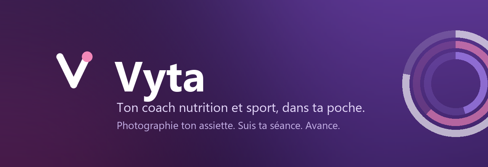
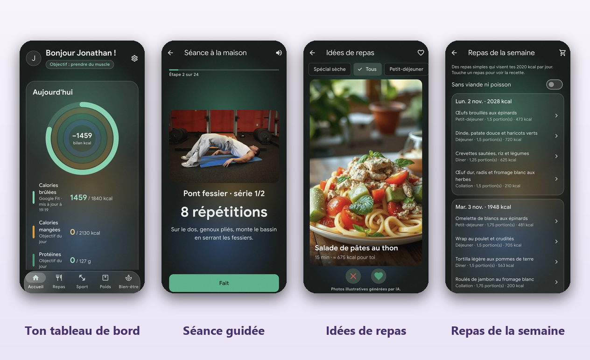
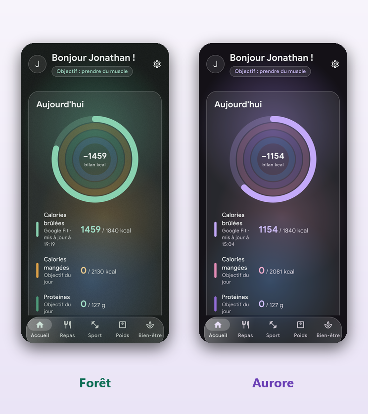

<p align="center">
  
</p>

<p align="center">
  <b>Photographie ton assiette. Suis ta séance. Vois ta progression.</b><br>
  Un coach complet pour Android, en français, gratuit, sans publicité et sans abonnement.
</p>

<p align="center">
  <a href="https://github.com/Jonathanmx5/coach/releases/latest"></a>
  <a href="https://github.com/Jonathanmx5/coach/releases"></a>
  
  <a href="https://github.com/Jonathanmx5/coach/actions/workflows/controle.yml"></a>
</p>

<p align="center">
  <a href="https://github.com/Jonathanmx5/coach/releases/latest"><b>⬇&nbsp;&nbsp;Télécharger Vyta pour Android</b></a>
</p>

<br>

<p align="center">
  
</p>

<br>

## Pourquoi Vyta

|  |  |
|---|---|
| 🍽️ **Tu photographies, l'IA compte** | Plus de pesée ni de recherche dans un catalogue. Une photo de ton assiette, et tu as les calories, les protéines, les glucides et les lipides. Avec un verdict clair selon ton objectif : vert, orange ou rouge. |
| 🏋️ **Tu t'entraînes guidé** | Des séances construites pour ton niveau et pour le matériel que tu as vraiment. Une vidéo pour chaque exercice, un minuteur et une voix qui t'annonce la suite : tu n'as plus qu'à suivre. |
| 📈 **Tu vois où tu vas** | Poids, mensurations, photos de progression, séries de jours tenus. Les chiffres montent, la courbe descend, et tu sais enfin si ça marche. |
| 🔒 **Tes données sont à toi** | Tes photos restent sur ton téléphone, ton profil est hébergé en Europe et toi seul y accèdes. Aucune publicité, aucun pistage publicitaire, aucun abonnement. |

<br>

## Ce qu'il y a dedans

### 🍽️ Manger

- **Photo analysée par IA** — ton assiette ou un produit, avec le carton du coach selon ton objectif. L'IA qui doute te pose la question plutôt que d'inventer.
- **Code-barres** — scan d'un produit via Open Food Facts.
- **Correction facile** — chaque repas se rouvre, se corrige (portions, moment), et l'application retient tes habitudes.
- **Idées de repas** — des recettes à faire défiler, un filtre « spécial sèche », et un deck qui apprend de ce que tu aimes.
- **Repas de la semaine** — un planning calé sur ta cible calorique, et la liste de courses rangée par rayon.

### 🏋️ Bouger

- **Séances à la maison** — adaptées au matériel que tu coches : haltères, élastiques, barre de traction, kettlebell, banc, ou rien du tout.
- **Salle, course à pied, marche** — dont un programme de course sur 8 semaines.
- **Séance guidée** — vidéo de l'exercice, minuteur, annonces vocales, aperçu de l'exercice suivant pendant le repos.
- **Progression automatique** — les charges et les répétitions montent avec toi.
- **Récupération** — un score du matin à partir du sommeil, du cœur et de ton ressenti, et des routines d'étirements.

### 📈 Suivre

- **Poids et IMC** — courbe avec projection à 5 jours, mensurations, masse grasse.
- **Photos de progression** — gardées sur le téléphone, comparables par superposition.
- **Montre connectée** — lecture seule de Health Connect : pas, cœur, sommeil, calories. Donc Mi Fitness, Zepp Life, Google Fit, Samsung Health et les autres.
- **Bien-être** — hydratation calculée selon ton poids, ton effort et la météo ; rappels de compléments ; séries de jours tenus.
- **Widgets** — les anneaux du jour, l'hydratation et l'ajout d'un repas, directement sur ton écran d'accueil.
- **Sauvegarde** — tout ton historique exporté en fichier Excel, et réimportable.

<br>

## Deux ambiances, clair ou sombre

<p align="center">
  
</p>

<p align="center">
  <i>Choisis tes couleurs au premier lancement, ou change d'avis dans les réglages.<br>
  Thème clair, sombre ou automatique, interface en verre givré, texte agrandi pris en charge et anneaux décrits aux lecteurs d'écran.</i>
</p>

<br>

## Tes données t'appartiennent

- **Tes photos de progression ne sont jamais envoyées**, elles vivent et meurent sur ton téléphone.
- **La photo d'un repas part le temps de l'analyse**, et ni le relais ni le modèle d'IA ne la conservent. Une fois le repas validé, elle n'est gardée que sur ton téléphone ; seul le résultat rejoint ton journal.
- **Ton profil est hébergé en Europe** (Firebase), et toi seul peux y accéder.
- **Health Connect est lu, jamais copié.** Rien de ta montre ne part dans le cloud.
- **Pas de publicité, pas de pistage publicitaire, pas d'abonnement.** Les rapports de plantage se coupent dans les réglages.
- **Tout s'efface d'un bouton** : Réglages → « Supprimer mon compte et mes données ».
- La politique complète est dans [CONFIDENTIALITE.md](CONFIDENTIALITE.md).

<br>

## Installation

1. Ouvre la [dernière version](https://github.com/Jonathanmx5/coach/releases/latest) et télécharge le fichier `.apk`.
2. Ouvre-le sur ton téléphone. Android te demandera d'autoriser l'installation depuis cette source : c'est normal pour une application hors Play Store.
3. Vérifie l'empreinte SHA-256 indiquée dans les notes de version si tu veux être sûr du fichier.

Android 8 et plus, processeurs arm64. L'application prévient elle-même quand une nouvelle version est publiée.

<br>

---

<br>

## Pour les développeurs

### Organisation

| Dossier | Contenu |
|---|---|
| `app/` | L'application Flutter (Android). |
| `relais/` | Le relais Cloudflare Worker pour l'analyse des photos ([détails](relais/README.md)). |
| `firebase/` | Les règles Firestore et leurs tests. |
| `docs/superpowers/` | Les spécifications et les plans. |
| `docs/images/` | Les visuels de cette page, refaits par `app/tool/generer_visuels_github.py`. |

### Lancer le projet

```bash
cd app
flutter pub get
flutter test
flutter run
```

La configuration Firebase du dépôt (`google-services.json`, `firebase_options.dart`) n'est pas secrète : ces identifiants sont publics par conception, la sécurité repose sur les règles Firestore (`firestore.rules`) et sur l'authentification.

Pour activer la photo de repas, déployer le relais puis compiler avec `--dart-define=RELAIS_URL=<adresse>`.

La signature et la publication sont décrites dans [PUBLICATION.md](PUBLICATION.md).

<br>

## Licence

Aucune licence : le code est visible, mais tous droits sont réservés. Pour le réutiliser, demander l'accord de l'auteur.

## Crédits

- **Photos des exercices** (`app/assets/exercices/`) : [free-exercise-db](https://github.com/yuhonas/free-exercise-db), licence Unlicense (domaine public), réduites à 720 × 480 px. Script : `app/tool/telecharger_exercices.mjs`.
- **Vidéos des exercices** (`app/assets/videos/`) : extraits de [wger](https://wger.de), auteur Goulart, licence [CC BY-SA 4.0](https://creativecommons.org/licenses/by-sa/4.0/) ; raccourcis à 6 s et recompressés (720 px, sans son), ces extraits restent sous CC BY-SA 4.0. Script : `app/tool/telecharger_videos.mjs`.
- **Valeurs nutritionnelles** (`relais/donnees/ciqual.json`, `app/assets/ciqual.json`) : ANSES, Table Ciqual 2020 ([doi:10.5281/zenodo.4770600](https://doi.org/10.5281/zenodo.4770600)), licence [CC BY 4.0](https://creativecommons.org/licenses/by/4.0/) ; extrait (énergie et macronutriments pour 100 g) converti en JSON.
- **Produits scannés** : [Open Food Facts](https://world.openfoodfacts.org/), base collaborative sous licence [ODbL](https://opendatacommons.org/licenses/odbl/1-0/), contenu sous [Database Contents License](https://opendatacommons.org/licenses/dbcl/1-0/). Les données consultées ne sont pas copiées dans l'application.
- **Photos des recettes** (`app/assets/recettes/`) : illustrations générées par IA (modèle flux-1-schnell, licence Apache 2.0).
